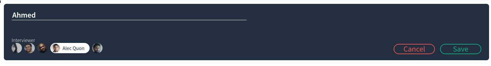
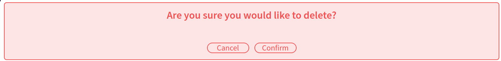

# Interview Scheduler

**React single-page application · Historical project (2021)**

An interview appointment scheduling application built as an earlier full-stack learning project. The frontend shows available appointment slots, supports creating/editing/deleting interviews, and communicates with a JSON API backed by PostgreSQL.

## What it demonstrates

- Component-based React UI and custom state-management hooks
- HTTP requests with Axios and persistence through a separate API
- Component and hook testing with Jest / React Testing Library
- Storybook component development and Cypress test setup

## Screenshots

| Appointments | Editing |
| --- | --- |
|  |  |

| Create appointment | Delete confirmation |
| --- | --- |
|  |  |

## Run locally

This is a **legacy learning project**, not a deployed service supported today. It uses older versions of React, Create React App, Node Sass, Storybook and other packages, so it may require compatibility fixes on a modern Node.js installation.

1. Install dependencies: `npm install`.
2. Start a compatible scheduler backend and PostgreSQL database. The companion [scheduler-api](https://github.com/achau11/scheduler-api) repository is a **fork of the course API**, not an independently authored backend.
3. Check the API/proxy configuration in `package.json` and change the historical Heroku endpoint to your local backend if needed.
4. Start the frontend: `npm start`.
5. Run tests with `npm test`, Storybook with `npm run storybook`, or Cypress with `npm run cypress` if the legacy tooling is compatible.

The previous Heroku demo address is historical and **not maintained or verified**.

## Project context

This repository documents earlier React development experience. It should be evaluated as a learning-era application, not as a current production system or a statement about the technologies I use in professional work today.
